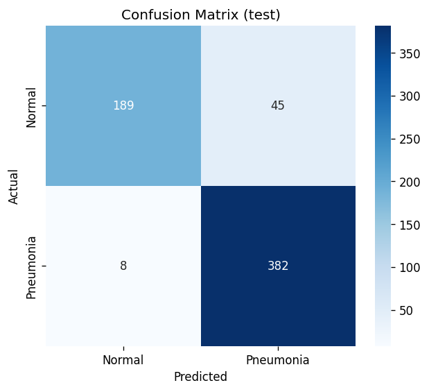
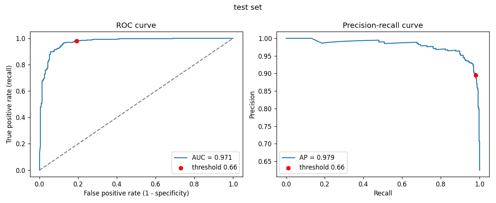
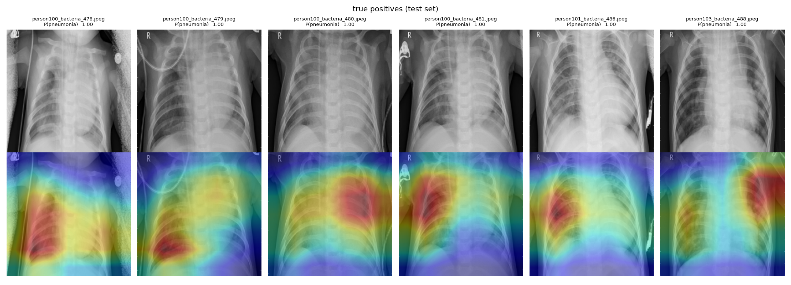
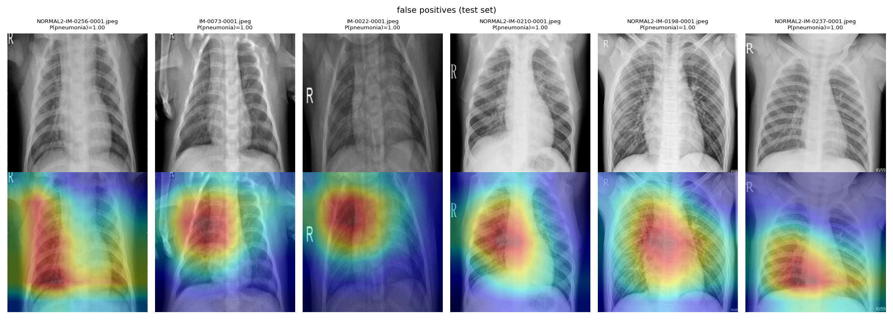
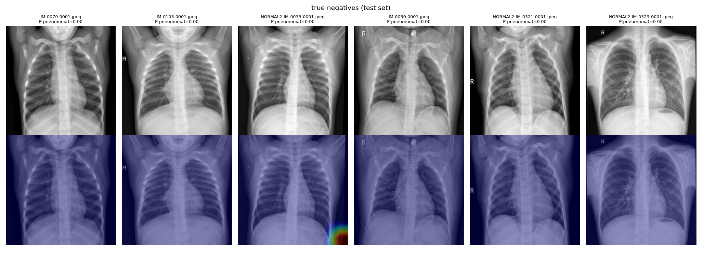

# Pneumonia Detection from Chest X-Rays
Deep learning system that detects pneumonia from chest X-ray images using a fine-tuned ResNet-18 model in PyTorch, with patient-level validation, a recall-targeted decision threshold, bootstrap confidence intervals and Grad-CAM explanations.

## Overview
This project addresses the challenge of accurately identifying pneumonia from chest X-rays, with a focus on minimizing false negatives in a medical screening context. The model catches 98% of pneumonia cases on the test set, and Grad-CAM is used to analyze where and why it makes mistakes.

## How It Works
**Model Pipeline:**

1. Image Input → Chest X-ray resized to 224×224 and normalized  
2. Feature Extraction → Pretrained ResNet-18 backbone  
3. Fine-Tuning → Unfreeze layer4 and classifier head  
4. Classification → Binary output (Normal vs Pneumonia)  
5. Thresholding → Decision threshold chosen on the validation set to keep recall ≥ 95%

## Key Technical Decisions:

- **Patient-Level Validation Split:** The official validation folder has only 16 images. Training and validation data are pooled and re-split 85/15 by patient (4,484 / 748 images) so no patient appears in both sets  
- **Pretrained Transfer Learning:** Leverages ImageNet weights to improve generalization on limited medical data  
- **Selective Layer Freezing:** Reduces overfitting and training time  
- **Class-Weighted Loss:** Weights computed from class frequencies to address the ~2.9:1 Pneumonia-to-Normal imbalance  
- **ROC-AUC Checkpointing:** Model selected by validation ROC-AUC, which measures ranking quality independent of threshold  
- **Validation-Chosen Threshold:** The highest-precision threshold that keeps validation recall ≥ 95%, applied once to the test set  
- **Training Stability:** Learning-rate halving on plateau, early stopping (best epoch 9, stopped at 14) and fixed random seeds for reproducibility

## Evaluation
**Test Set (624 images, 95% bootstrap confidence intervals):**

| Metric | Value | 95% CI |
|---|---|---|
| Recall | 97.95% | 96.4–99.2 |
| Specificity | 80.77% | 75.3–86.0 |
| Precision | 89.46% | 86.5–92.3 |
| F1 Score | 93.51% | 91.8–95.2 |
| Accuracy | 91.51% | 89.3–93.8 |
| ROC-AUC | 97.15% | 95.8–98.3 |

The model catches 382 of 390 pneumonia cases, at the cost of 45 false alarms on 234 normal X-rays.

<p align="center">
  
  
</p>

**Validation vs. Test:** Validation specificity is 99.48% but test specificity is 80.77%. The confidence intervals don't overlap, so the test images are genuinely harder for the model rather than the gap being due to chance.

## Grad-CAM Analysis
Grad-CAM highlights the image regions that pushed the model toward predicting pneumonia.

- **Correct pneumonia predictions:** attention is on the lung fields over visible opacities, not on markers, text or medical devices  
- **False positives:** made with near-total confidence, often on low-contrast or hazy normal X-rays, suggesting the model partly relies on overall lung haziness, which likely explains the validation/test gap  
- **Missed cases:** mostly borderline scores (0.3–0.5), two of them viral pneumonia, which tends to appear more diffuse

**True positives:**


**False positives:**


**True negatives:**


## Usage
```bash
pip install -r requirements.txt
# Download the Kaggle "Chest X-Ray Images (Pneumonia)" dataset into data/train, data/val, data/test

python src/train.py      # train; saves best_pneumonia_model.pth and threshold.json
python src/evaluate.py   # metrics, confidence intervals and plots -> results/
python src/gradcam.py    # Grad-CAM heatmaps -> results/gradcam/
```

## Limitations
- Pediatric X-rays from a single hospital; performance on adults or other hospitals is unknown  
- Research project, not a medical device

## Tech Stack
**Deep Learning:** PyTorch, Torchvision  
**Data Processing:** NumPy, Pillow  
**Evaluation:** Scikit-learn  
**Visualization:** Matplotlib, Seaborn

## Contact
Vivaan Motwani  
https://github.com/vivaanm867